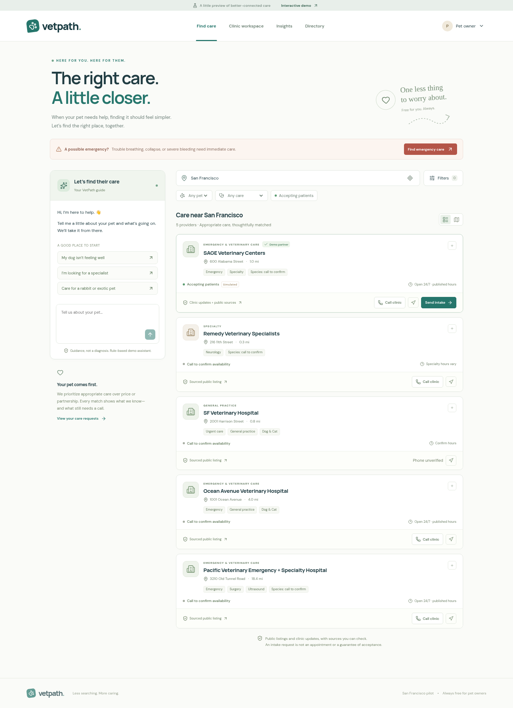

# VetPath

A veterinary care marketplace demo built from scratch with **Next.js 16, TypeScript, React 19, and PostgreSQL 17**. Owner discovery, clinic operations, directory management, and insights share one database and backend.

**Public demo:** https://vetpath-web-production.up.railway.app

The deployed app uses Next.js and a private PostgreSQL service on Railway. Use fictional data; clinic roles, partnerships, and intake availability are simulated.



## Run locally

Requirements: Node.js 22.21+ and Docker (or an existing PostgreSQL 17+ server).

```sh
npm ci
cp .env.example .env.local
# Replace SESSION_SECRET with a random value (at least 32 characters).
# Generate one with: openssl rand -hex 32
docker compose up -d db
npm run db:setup
npm run dev
```

Open <http://localhost:3000>. The seed is idempotent and runs only when the provider directory is empty. PostgreSQL data persists in a Docker volume. `DATABASE_URL` can point to an existing database instead.

For the complete production-mode container stack, put `SESSION_SECRET=<random value>` and optionally `POSTGRES_PASSWORD=<random value>` in an untracked `.env`, then run:

```sh
docker compose up --build -d
```

The app runs the schema/seed on startup, waits for database health, and serves on <http://localhost:3000>. Both exposed ports bind to loopback. Change passwords before deployment. `docker compose down` preserves database data.

## Try the connected demo

1. **Find care:** describe a fictional pet’s problem. Edit species, care type, location, and radius. Compare up to three clinics. Call links use `tel:` and directions open Google Maps.
2. **Send an intake:** choose SAGE’s simulated partnership, enter fictional information, and submit. Use “View your care requests” for edits and in-app messages.
3. **Clinic workspace:** use a **different browser profile/incognito session**. Choose SAGE, review the new intake, record an assessment, add a private note, and move it through Reviewing → Expected/Arrived → In care → Discharged. Messages are visible to the owner; clinical notes are not.
4. **Availability:** publish Limited or At capacity and watch the owner window update within four seconds. Status becomes Unknown after one hour. Update services/species and staff coverage.
5. **Handoffs:** in Directory, enable a second demo partnership. Request a handoff from a patient. Switch to the receiving clinic and accept it. The intake moves to that clinic, and the owner retains access.
6. **Directory:** edit a sourced hospital field, then import `data/hospitals.csv` or sync the linked Google Sheet. Review any protected-field conflicts. Keep the staff value or apply the spreadsheet value.
7. **Insights:** see searches, categories, species, filter changes, comparisons, contact clicks, intakes, staff-confirmed arrivals, workload, and operational activity. Export the selected period as JSON.

The role menu intentionally creates **demo** sessions; it is not production staff authentication. Separate sessions prevent switching roles from changing another window’s role. Staff sessions are restricted to their selected clinic. An owner can access only their own session’s requests. Demo owner identity expires after 24 hours.

## Data and provenance

- Original spreadsheet: [Veterinary Emergency-Care Interview Tracker](https://docs.google.com/spreadsheets/d/1Bm70UnTK56-J-U9bgxAUKzTwmA6JIlIn8DYnUudk_TE/edit?gid=440460470#gid=440460470).
- Five interview rows become **four hospital records**; both MedVet interviews are retained.
- Three additional San Francisco public listings produce **seven hospitals total**. See [source notes](docs/SOURCES.md).
- All initial hospitals are nonpartners except SAGE’s **explicitly simulated** partnership. Fictional patients and staff are clearly labeled. No real clinic is contacted.
- Unknown species, phone numbers, pricing, and intake status remain unknown. VEG Sacramento’s exact branch is unresolved and is not given fabricated contact details or a precise map pin.
- Every listing includes its source, source-check date, and update time. Historical interview prices are qualified and never determine emergency ranking.
- Imports match source ID, normalized phone, or name + city. Staff edits are protected, changes use optimistic version checks, and conflicts have explicit resolution. Imports are transactional and serialized.
- Admin auto-sync polls the fixed Google Sheet once a minute **while the administrator page remains open**. Every screen polls database changes every four seconds. No background cron is provisioned.

The schema is in [data/schema.sql](data/schema.sql), with relational providers, original interviews, intakes, notes, messages, staff coverage, handoffs, events, imports, conflicts, and audit records. There is no localStorage persistence or substitute in-memory database.

## Guided search and optional AI

The default assistant is **explicitly labeled rule-based** and needs no AI key. It extracts demo species, care categories, locations, and conservative emergency cues. Set `OPENAI_API_KEY` to enable optional OpenAI filter extraction (`OPENAI_MODEL`, default `gpt-4.1-mini`). Only the owner’s chat message is sent to that API; provider ranking, capabilities, costs, and explanations use database facts. Do not enter real personal or medical information in the demo.

AI extraction has a strict validated output shape and a deterministic fallback. Model failure cannot disable the local emergency cues. This is not diagnosis, clinical triage, a guarantee of acceptance, or a comprehensive emergency detector. Urgent symptoms trigger prominent emergency guidance and distance-first emergency results, overriding price, availability, and radius preferences.

Manual locations are limited to the documented Bay Area city/ZIP suggestions. Browser geolocation works when permission is granted. Distances are approximate straight-line distances, not travel times. The area overview is a text overview; Google Maps provides actual directions.

## Verify

```sh
npm run typecheck
npm test
npm run build
npm run test:e2e
```

Playwright uses `/usr/bin/chromium` by default in this environment. Elsewhere:

```sh
npx playwright install chromium
CHROMIUM_PATH="$(node -e "console.log(require('playwright').chromium.executablePath())")" npm run test:e2e
```

Use a **disposable PostgreSQL database** for browser tests: tests create fictional records and exercise imports/partnerships. `npm run db:setup` initializes the chosen `DATABASE_URL`. `BASE_URL` tests an already running app; otherwise Playwright starts the development server. GitHub Actions runs a fresh PostgreSQL service, a production build, and the browser suite. Reports and failure traces are retained as CI artifacts. See [test evidence](docs/TESTING.md).

## Deployment

See [deployment instructions](docs/DEPLOYMENT.md) for Docker and Node hosting, environment variables, health checks, and remaining dependencies. The public demo and PostgreSQL database are deployed on Railway. Real clinical use still requires identity verification, operational agreements, and live integrations.
